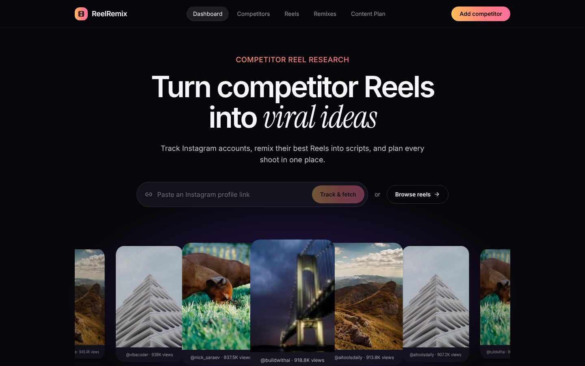
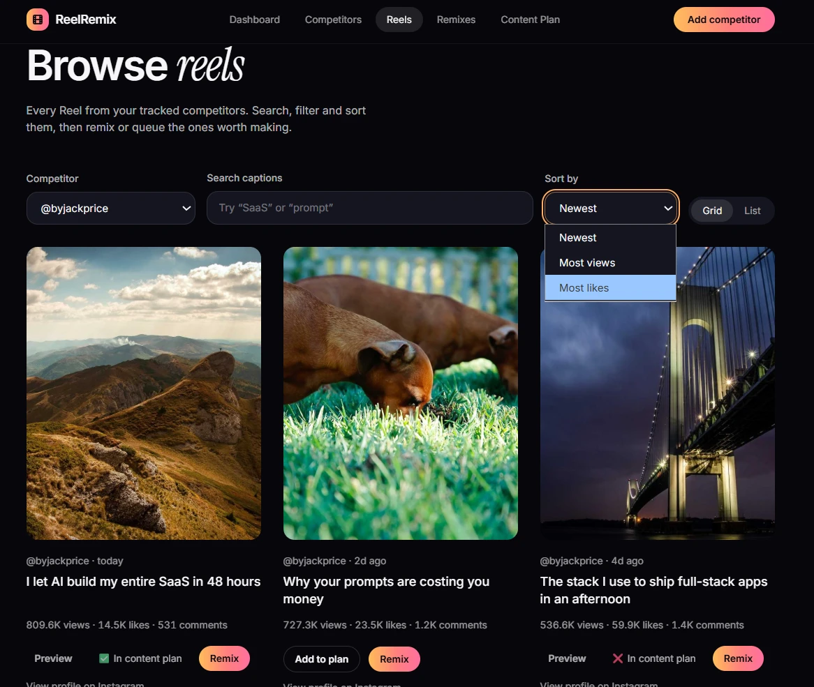
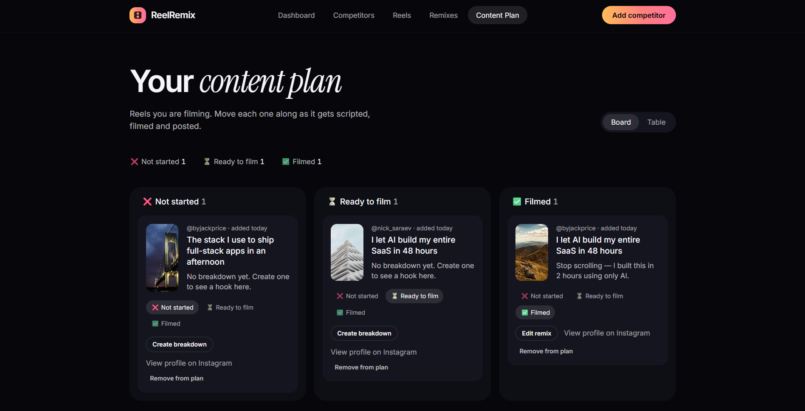
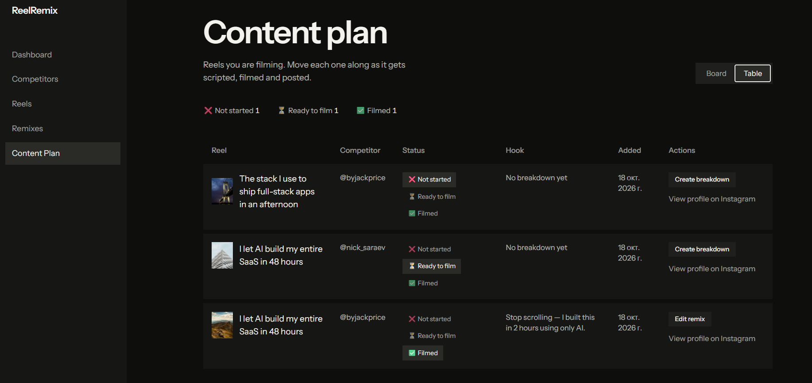
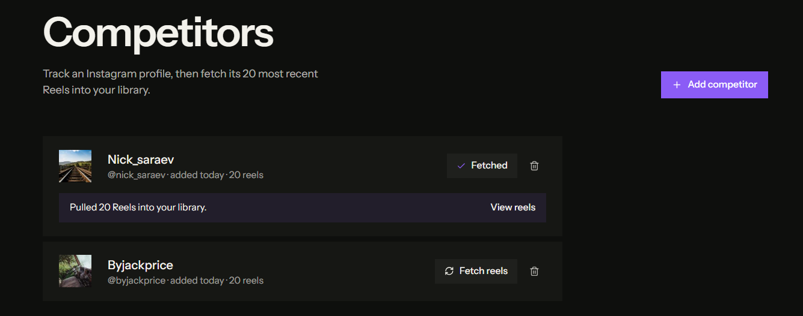
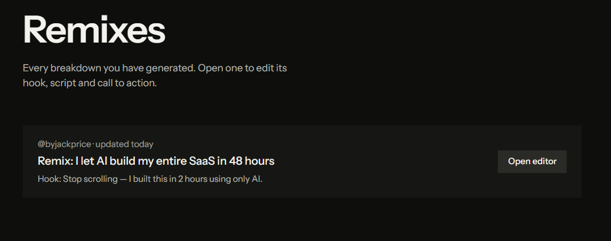
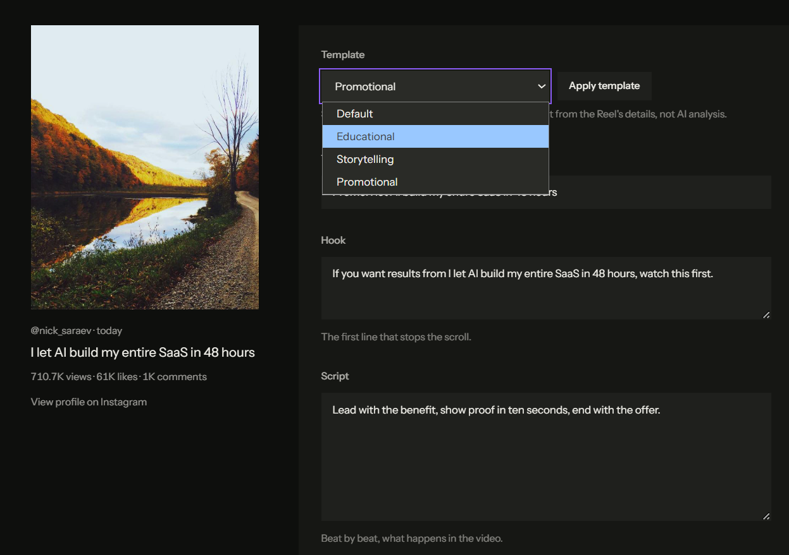

# Competitor Reels Tool

Track Instagram competitors, pull their 20 most recent Reels into a library, and generate an AI breakdown (hook, script, CTA) for any Reel that you can edit.

- **Frontend:** React, Vite, TypeScript, Tailwind (`frontend/`)
- **Backend:** FastAPI, SQLAlchemy, SQLite (`backend/`)
- **Contract:** [`openapi.yaml`](openapi.yaml)
- **Agent guidance:** [`AGENTS.md`](AGENTS.md)

## Screenshots

| Dashboard | Reels | Content plan (board) | Content plan (table) |
| --- | --- | --- | --- |
|  |  |  |  |

| Competitors | Remixes | Remix editor |
| --- | --- | --- |
|  |  |  |

## Run it locally

Requirements: [uv](https://docs.astral.sh/uv/), Node.js 20+, and `make`.

```bash
make install   # install backend and frontend dependencies
make dev       # start the API on :8091 and the web app on :5173
```

Open **http://localhost:5173**.

1. Go to **Competitors** and paste an Instagram profile URL (or `@username`).
2. Click **Fetch reels** to pull 20 Reels into the library.
3. On the **Reels** page, click **Remix** on any Reel to generate a breakdown, then edit it and save.
4. Click **Add to plan** on any Reel to queue it for filming. Track each one on the **Content Plan** page with ❌ not started, ⏳ ready to film, or ✅ filmed.

Data is stored in `backend/data/app.db` and survives restarts. Delete that file to start fresh.

API docs are at http://localhost:8091/docs while the backend runs.

## Deploying

The frontend, API and database deploy to Render from `render.yaml`. See [`docs/deploy.md`](docs/deploy.md).

### Running the pieces separately

```bash
make run        # backend only
make frontend   # frontend only (needs the backend running for data)
```

### Tests

```bash
make test       # backend (pytest) and frontend (vitest)
make check      # tests, typecheck and production build
```

## Notes

- Competitor Reels are **sample data**. The backend generates them the same way the original frontend mock did, because scraping Instagram is outside this project's scope. `backend/app/generator.py` is the single place to replace it with a real source.
- Remixes are produced by a **template**, not an LLM. Swap `build_remix` in `backend/app/generator.py` to call a model.
- There is no login. Anyone who can reach the server can use it.
- Set `DATABASE_URL` (for example `sqlite:///./data/app.db`) to change the database. The code is written so Postgres can be added later.
- To point the frontend at a backend elsewhere, set `VITE_API_BASE_URL` (for example `https://api.example.com/api`).
