# Clip-Remix

Track competitor YouTube channels, pull their latest videos into a library, generate an editable breakdown (hook, script, CTA) for any video, and plan your shoots. Real videos come from YouTube's public channel feeds, so no API key or account is needed.

- **Frontend:** React, Vite, TypeScript, Tailwind (`frontend/`)
- **Backend:** FastAPI, SQLAlchemy, SQLite (`backend/`)
- **Contract:** [`openapi.yaml`](openapi.yaml)
- **Agent guidance:** [`AGENTS.md`](AGENTS.md)

## Screenshots

| Dashboard | Videos | Content plan (board) | Content plan (table) |
| --- | --- | --- | --- |
| 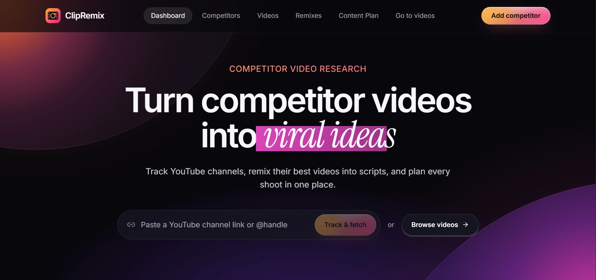 | 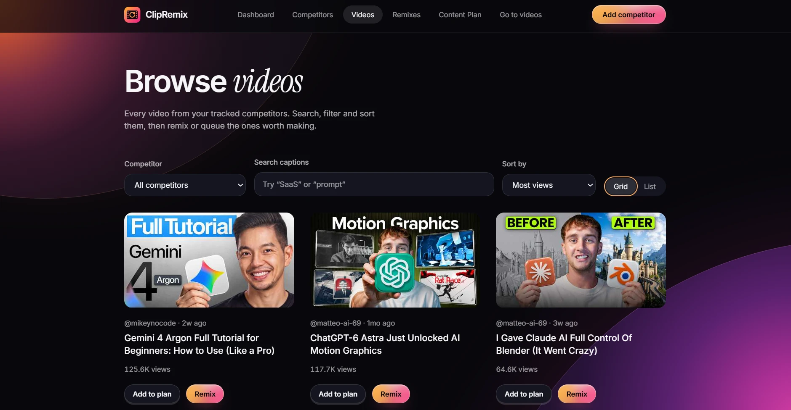 | 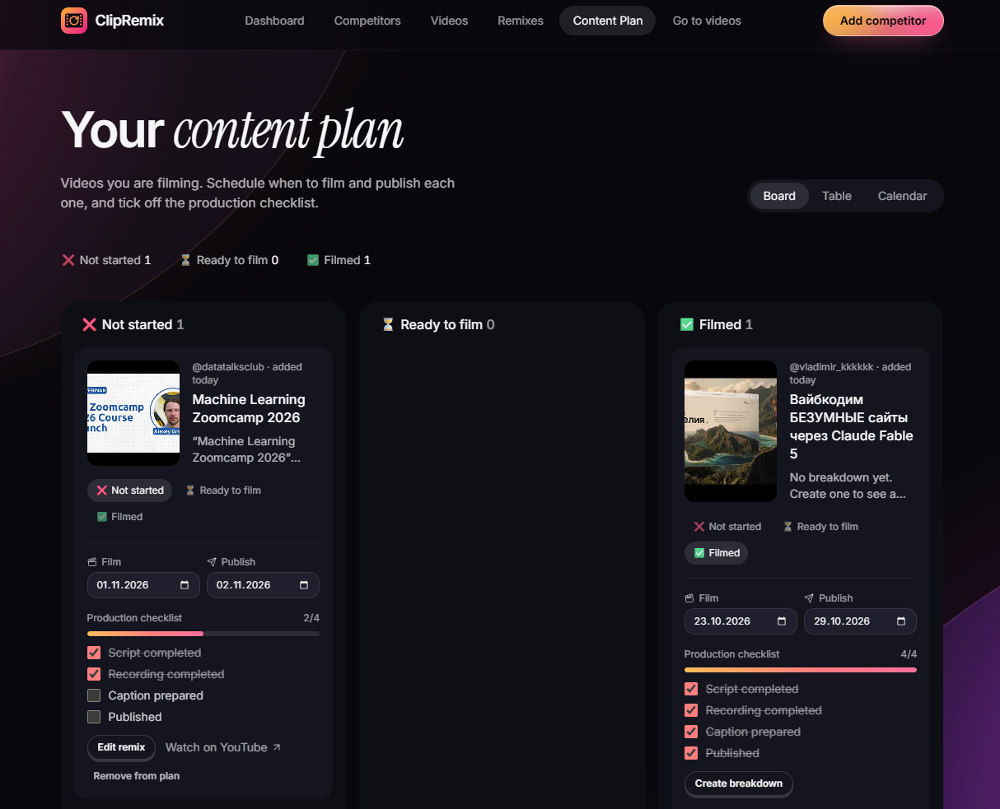 | 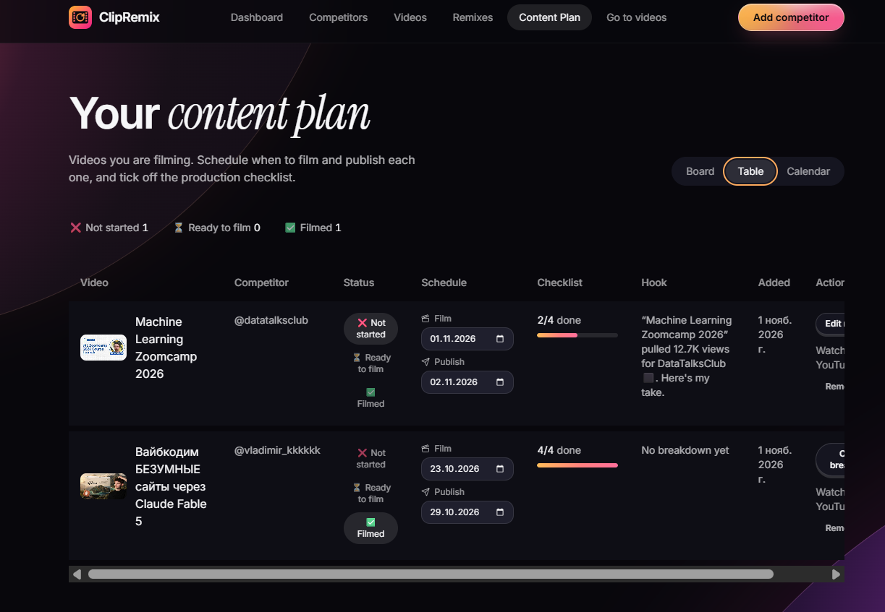 |

| Competitors | Remixes | Remix editor |
| --- | --- | --- |
| 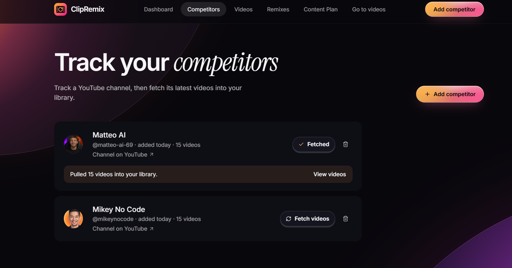 | 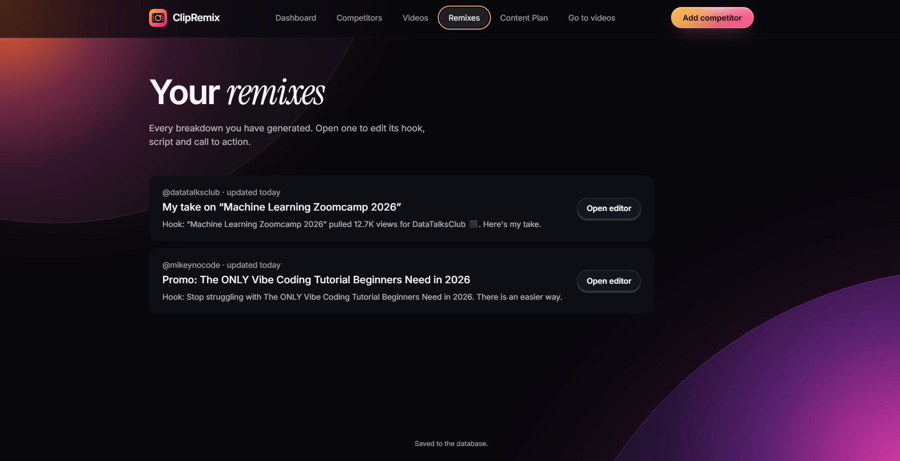 | 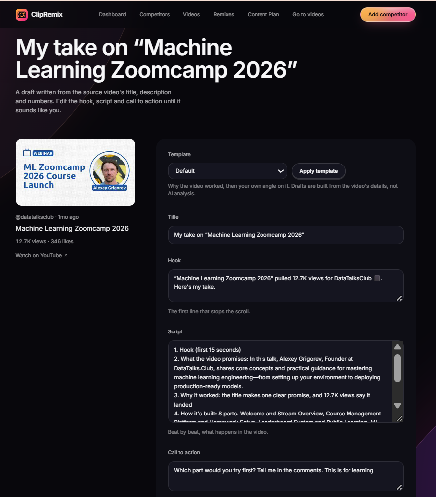 |

### More screens

| Content plan (calendar) | Videos list | Go to videos | Add a competitor |
| --- | --- | --- | --- |
| 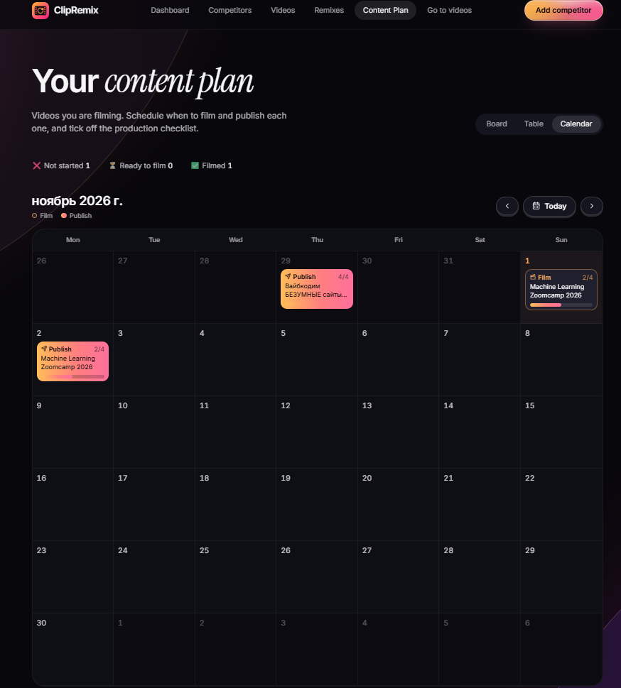 | 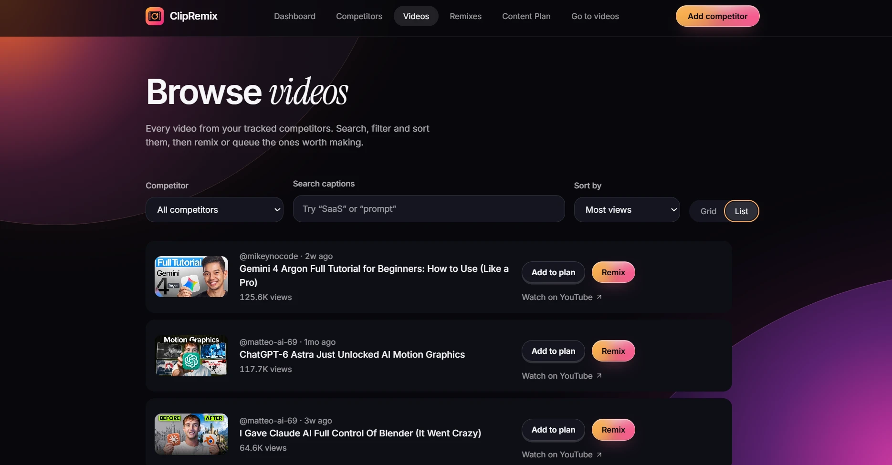 | 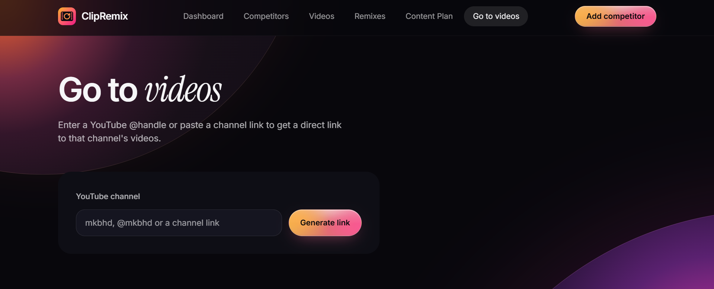 | 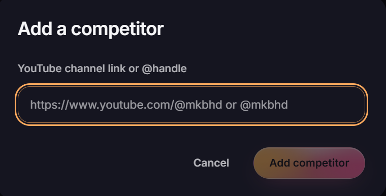 |

| Dashboard: top videos and channels | Dashboard: totals and progress | Dashboard: recent videos |
| --- | --- | --- |
| 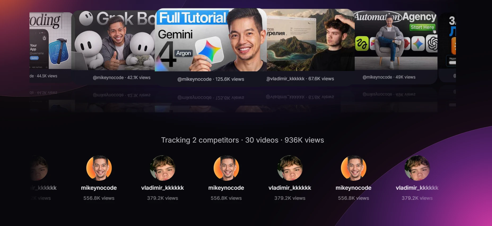 | 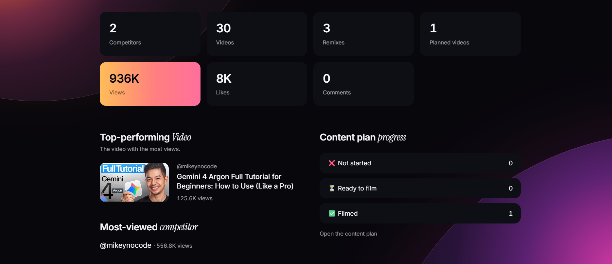 | 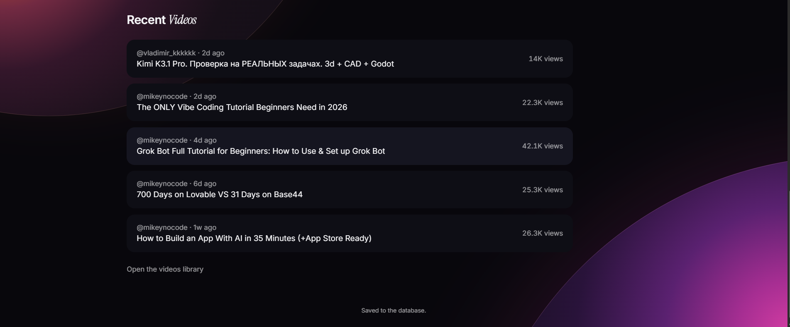 |

## Run it locally

Requirements: [uv](https://docs.astral.sh/uv/), Node.js 20+, and `make`.

```bash
make install   # install backend and frontend dependencies
make dev       # start the API on :8091 and the web app on :5173
```

Open **http://localhost:5173**.

1. Go to **Competitors** and paste a YouTube channel link, an `@handle`, or a link to one of the channel's videos.
2. Click **Fetch videos** to pull the channel's latest videos (up to 15) into the library.
3. On the **Videos** page, click **Remix** on any video to generate a breakdown, then edit it and save. **Watch on YouTube** opens the video itself.
4. Click **Add to plan** on any video to queue it for filming. Track each one on the **Content Plan** page with ❌ not started, ⏳ ready to film, or ✅ filmed.

Data is stored in `backend/data/clipremix.db` and survives restarts. Delete that file to start fresh.

API docs are at http://localhost:8091/docs while the backend runs.

### Run the production image

The `Dockerfile` builds one image: Node compiles the frontend into static files, and the FastAPI backend serves them next to the API.

```bash
make docker-build   # docker build -t clipremix:latest .
make docker-run     # http://localhost:8000, data kept in the clipremix-data volume
```

`GET /api/health` reports whether the app and its database are up.

### Run the full stack with Docker Compose

`docker-compose.yaml` runs the app with PostgreSQL, as in production:

```bash
docker compose up --build      # http://localhost:8100
make up                        # the same in the background, with sample videos, waiting until healthy
make integration               # integration tests against the running stack
make down
```

The app waits for PostgreSQL's health check before starting, and the database lives in the `pgdata` volume, so it survives `docker compose down` (add `-v` to wipe it). Set `VIDEO_SOURCE=sample` for generated videos without YouTube access.

### End-to-end tests

`e2e/` holds Playwright tests, one file per feature, each tracked by a GitHub issue labelled `e2e-test`. They run in Chromium against the Docker Compose stack, with sample videos:

```bash
cd e2e && npm ci && npx playwright install chromium   # once
make e2e                                              # resets the stack's database, starts it, then runs every test
```

`make e2e` runs `docker compose down -v` first, so it always starts from an empty database, like CI (this wipes the local stack's data).

Each test creates its own channel with a unique handle, so the suite also runs on a database that already holds data.

How every layer of tests fits together, the CI/CD pipeline, and how the e2e backlog was worked: [`docs/testing.md`](docs/testing.md).

## Deploying

ClipRemix deploys to [Render](https://render.com) as the same two services as `docker-compose.yaml`: one web service built from the `Dockerfile`, and a managed PostgreSQL 16 database. `render.yaml` describes both; see [`docs/deploy.md`](docs/deploy.md). Every push runs the backend, frontend, integration and end-to-end tests in GitHub Actions, and a push to `main` that passes them all is deployed automatically.

### Running the pieces separately

```bash
make run        # backend only
make frontend   # frontend only (needs the backend running for data)
```

### Tests

```bash
make test       # backend (pytest) and frontend (vitest)
make check      # tests, typecheck and production build
```

## Notes

- **Real videos, no key:** the backend reads each channel's public feed (`https://www.youtube.com/feeds/videos.xml?channel_id=UC…`) for the latest 15 videos with title, thumbnail, views and likes. The feed has no comment counts. When you add a channel by `@handle` or video link, the backend reads the channel's public page once to find its channel ID, name and avatar. The code is in `backend/app/youtube.py`.
- **Sample data:** set `VIDEO_SOURCE=sample` to use generated videos with no network access (the tests always do). Sample videos link to the channel, since they have no real page.
- **Upgrading from the Instagram version:** the database file is now `clipremix.db`, so the old `app.db` is left alone and the app starts empty.
- **Remixes are written from each video's own details**, not by an AI model: its title (how-to, tutorial, list, comparison, story, question), its description (the opening promise, the chapter list, what the creator offers), the channel name, the view count, and whether it is a Short. See `backend/app/remix.py`. Videos fetched before this change have no description stored; click **Fetch videos** again to get it.
- There is no login. Anyone who can reach the server can use it.
- Set `DATABASE_URL=sqlite://` to run with an in-memory database. Nothing is saved, which is useful for trying the API or for tests.
- **Database:** SQLite by default (`backend/data/clipremix.db`), PostgreSQL in production. Set `DATABASE_URL` to switch; `postgres://…` and `postgresql://…` URLs from hosting providers work as given. `make db` starts a local PostgreSQL 16 in Docker, and `make test-postgres` runs the backend tests against it.
- To point the frontend at a backend elsewhere, set `VITE_API_BASE_URL` (for example `https://api.example.com/api`).
